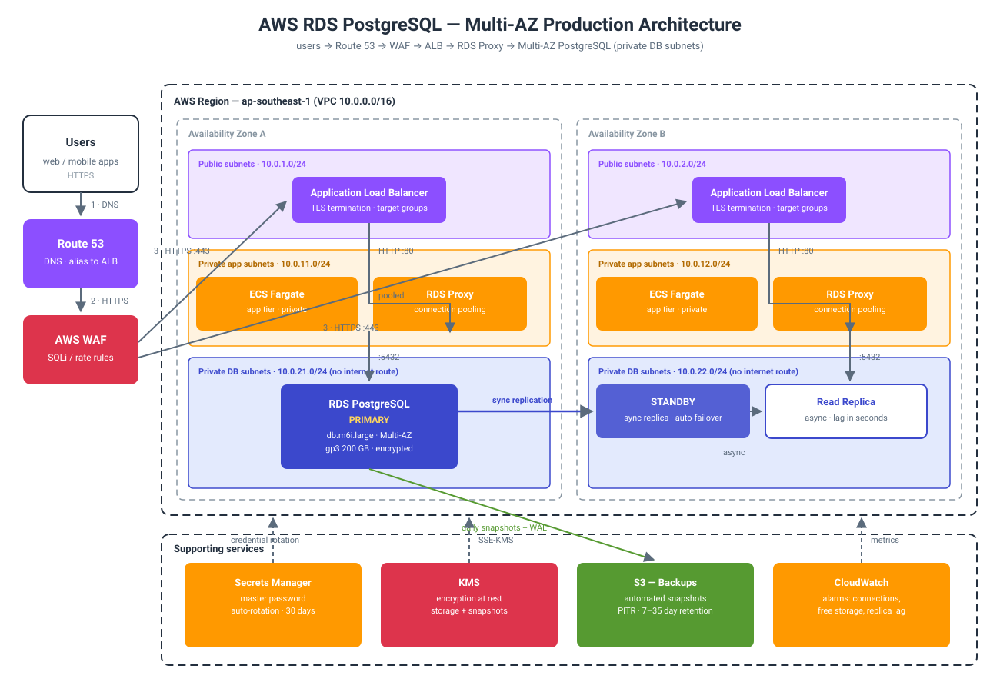

# AWS RDS PostgreSQL Guide — Production-Ready Relational Databases, Done Right


> **TL;DR:** Run PostgreSQL on AWS **without becoming a DBA**. RDS gives
> you automated backups, Multi-AZ failover, and patched engines — but only
> if you place it in private DB subnets, encrypt everything with KMS, pull
> credentials from Secrets Manager (never env files), and connect through
> **RDS Proxy** so your app's connection storms don't kill the database.
> Default to **db.t4g.micro** for dev, **Multi-AZ db instance** for prod,
> and add **read replicas only when reads are your bottleneck** — a replica
> is not a backup, and Multi-AZ is not a read scale-out.

## Why managed, and when *not*

You *can* install PostgreSQL on EC2. You then own: OS patching, WAL
archiving, replica lag monitoring, failover scripts at 3 AM, and backup
retention math. RDS buys all of that back as a managed service:

- **Automated backups** — daily snapshots + transaction-log capture,
  point-in-time recovery down to the second within your retention window.
- **Multi-AZ failover** — synchronous standby in another AZ, automatic
  failover with the same endpoint (DNS flip, ~1–2 minutes).
- **Engine patching** — minor version upgrades with a maintenance window
  you choose, not a pager you dread.

**Don't use RDS when:** you need extensions AWS doesn't support, custom
OS-level tuning, or you're running a workload that fits DynamoDB's
key-value access patterns better (see the
[DynamoDB data modeling guide](https://github.com/sepkascurty-cpu/dynamodb-data-modeling-guide)).
And check the **pricing model, free-tier limits, region, and duration
before creating anything** — an idle Multi-AZ instance bills 24/7.

## Choosing the right relational shape

| | RDS PostgreSQL | Aurora PostgreSQL | PostgreSQL on EC2 | DynamoDB |
| --- | --- | --- | --- | --- |
| Managed backups / PITR | Yes | Yes (continuous) | You build it | Yes (PITR) |
| Multi-AZ failover | Yes (sync standby) | Storage-level, ~instant | You build it | Built-in (global tables) |
| Read scaling | Read replicas (async, lag) | Up to 15 replicas, shared storage | You build it | RCU/WCU scaling |
| Scaling writes | Vertical (resize) | Serverless v2 autoscale | Vertical | Horizontal partitions |
| Extensions / superuser | Most; no superuser | Most; no superuser | Full control | N/A |
| Cost profile | Instance-hours + storage | IOs + instance hours | Instance + your time | Request throughput |
| Best for | Classic OLTP, reporting | Variable/spiky workloads | Special extensions, legacy | Key-value, huge scale |

**Default choice: RDS PostgreSQL.** Move to Aurora when write scaling or
fast failover justifies the IO-based pricing; move to EC2 only when you
need something RDS forbids.

## Architecture



Traffic flow, step by step:

1. **Client → Route 53 → ALB** — DNS alias to the Application Load
   Balancer in public subnets; TLS terminates at the ALB.
2. **App tier (private)** — ECS Fargate tasks or EC2 in private app
   subnets talk to the database through the **RDS endpoint**, never a
   hardcoded IP. Security groups allow `5432` *only* from the app tier's
   security group.
3. **RDS Proxy in between** — pools and shares connections so 500 app
   tasks don't open 500 direct PostgreSQL connections (each backend
   process costs RAM). Also makes failovers faster: the proxy drains and
   reconnects, your app just retries.
4. **Primary + standby (Multi-AZ)** — synchronous replication to the
   standby in AZ-b; failover flips the endpoint automatically. This is
   for **availability**, not performance.
5. **Read replica (optional)** — async replica for read-heavy analytics;
   expect seconds of lag and never point writes at it.
6. **Backups & secrets** — automated snapshots to S3 (retention 7–35
   days), credentials in Secrets Manager with automatic rotation,
   encryption at rest via KMS, CloudWatch alarms on `FreeStorageSpace`,
   `DatabaseConnections`, and `ReplicaLag`.

## Core concepts (one minute each)

### Multi-AZ ≠ read replica ≠ backup — the three are different tools

The most common confusion in RDS. Memorize this:

- **Multi-AZ standby** — *availability*. Same data, other AZ, automatic
  failover. You can't query it. Costs roughly 2× the instance.
- **Read replica** — *read scaling*. Async, has lag, you query it, it can
  be promoted — but promotion is manual (or scripted). Not a backup.
- **Automated snapshot** — *recovery*. Point-in-time restore to a *new*
  instance. The only thing that saves you from `DROP TABLE`.

```hcl
# The three knobs, in Terraform — see main.tf for the full stack
resource "aws_db_instance" "primary" {
  multi_az               = true   # availability: sync standby in AZ-b
  backup_retention_period = 7     # recovery: 7 days of PITR
  # ...
}

resource "aws_db_instance" "replica" {
  replicate_source_db = aws_db_instance.primary.identifier  # read scaling
}
```

### Credentials: Secrets Manager + IAM auth, never plaintext

Store the master password in **Secrets Manager** and rotate it
automatically. Better: use **IAM database authentication** — the app
gets a 15-minute auth token from IAM instead of a password, so there is
*no static secret to leak at all*. It works with RDS Proxy too.

```python
# Get a short-lived auth token instead of storing a password (boto3)
import boto3

rds = boto3.client("rds", region_name="ap-southeast-1")
token = rds.generate_db_auth_token(
    DBHostname="mydb.abc123.ap-southeast-1.rds.amazonaws.com",
    Port=5432,
    DBUsername="app_user",
    Region="ap-southeast-1",
)
# connect with: psycopg2.connect(host=..., user="app_user", password=token, sslmode="require")
```

### Parameter groups — tune without touching the box

Engine settings live in a **DB parameter group** (e.g.
`max_connections`, `shared_buffers`, `log_min_duration_statement`).
Create your own parameter group, version it in Terraform, and apply
changes with `apply_method = "pending-reboot"` where needed — never
edit the default group in the console and forget what you changed.

### Cost guardrails (learned the hard way)

- **Stop dev instances nightly** — `aws rds stop-db-instance` (stopped
  up to 7 days, then auto-starts; you still pay for storage).
- **Single-AZ for dev/staging**, Multi-AZ only for prod.
- **gp3 storage** over io2 unless you can prove the IOPS need.
- **Reserved Instances / Savings** for steady prod workloads; watch
  `FreeStorageSpace` — autoscaling storage only grows, never shrinks.
- Set a **billing alarm** before you create the instance, not after.

## Quick start

```bash
terraform init
terraform plan -out tfplan     # read the plan: check instance class, Multi-AZ, region
terraform apply tfplan
# connect through the proxy endpoint (from the app subnet / VPN only):
psql "host=$(terraform output -raw proxy_endpoint) port=5432 dbname=appdb user=app_user sslmode=require"
```

## Quiz

Think you got it? [Take the 5-question quiz →](quiz.md)

## Further reading

- [AWS VPC networking guide](https://github.com/sepkascurty-cpu/aws-vpc-networking-guide) — subnets and security groups this stack assumes
- [AWS IAM least privilege guide](https://github.com/sepkascurty-cpu/aws-iam-least-privilege-guide) — scoping the app's DB role
- [AWS cost optimization guide](https://github.com/sepkascurty-cpu/aws-cost-optimization-guide) — FinOps guardrails
- [DynamoDB data modeling guide](https://github.com/sepkascurty-cpu/dynamodb-data-modeling-guide) — when *not* to use RDS
